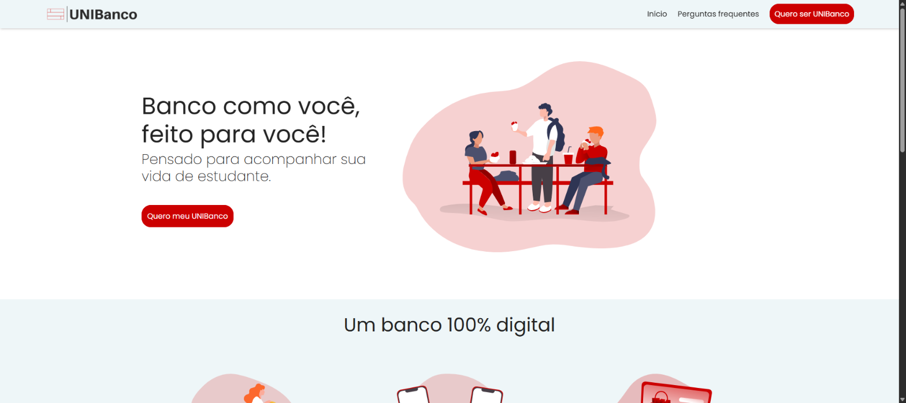
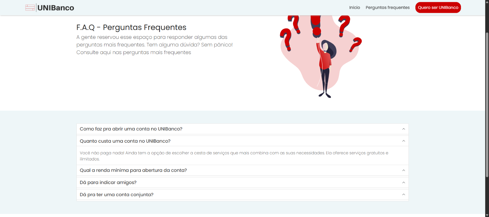
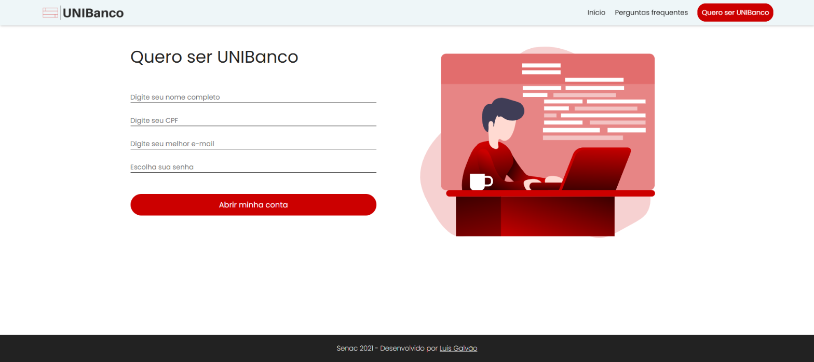
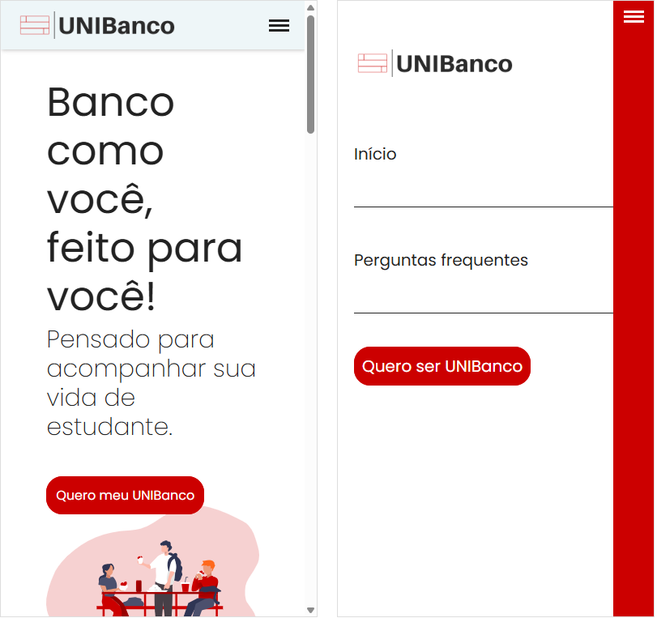

<div align="center">

<picture>
  <source media="(prefers-color-scheme: dark)" srcset="docs/logo-unibanco-tema-escuro.png">
  
</picture>

### Banco como você, feito para você!

Landing page de um banco digital fictício pensado para universitários.<br>
Projeto acadêmico do curso de Tecnologia em Sistemas para Internet (TSI) do Senac.

<br>

<a href="https://sasuzin.github.io/Projeto-Banco/"></a>

<br><br>


</div>

---

## Sumário

- [Sobre o projeto](#sobre-o-projeto)
- [Prévia](#prévia)
- [Páginas](#páginas)
- [Funcionalidades](#funcionalidades)
- [Tecnologias](#tecnologias)
- [Identidade visual](#identidade-visual)
- [Estrutura de pastas](#estrutura-de-pastas)
- [Como rodar localmente](#como-rodar-localmente)
- [Publicação no GitHub Pages](#publicação-no-github-pages)
- [Créditos](#créditos)
- [Autor](#autor)

---

## Sobre o projeto

O **UNIBanco** é a vitrine de um banco digital fictício voltado para estudantes universitários. O site apresenta o banco, responde às dúvidas mais comuns e convida o visitante a abrir uma conta.

Foi desenvolvido como projeto do 2º semestre do curso de **Tecnologia em Sistemas para Internet (TSI)** do **Senac**, com o objetivo de praticar:

- estruturação semântica de páginas com HTML5;
- estilização com CSS3 e organização do CSS por página;
- layout responsivo com o grid do Bootstrap;
- componentes interativos (accordion) e um menu mobile feito em JavaScript puro;
- publicação de um site estático no GitHub Pages.

> O UNIBanco não é um banco de verdade. Todo o conteúdo é ilustrativo, e o formulário de cadastro não envia dados para lugar nenhum.

---

## Prévia

<div align="center">

**Página inicial**



<br><br>

**Perguntas frequentes**



<br><br>

**Quero ser UNIBanco (cadastro)**



<br><br>

**No celular: página inicial e menu aberto**



</div>

---

## Páginas

| Página | Arquivo | O que tem |
| --- | --- | --- |
| **Início** | [`index.html`](index.html) | Chamada principal ("Banco como você, feito para você!"), a seção *Um banco 100% digital* com saques, transferências e pagamentos, os benefícios para universitários, o cashback e os botões que levam ao cadastro. |
| **Perguntas frequentes** | [`faq.html`](faq.html) | Accordion com as dúvidas mais comuns: como abrir a conta, quanto custa, renda mínima, indicação de amigos e conta conjunta. |
| **Quero ser UNIBanco** | [`form.html`](form.html) | Formulário de abertura de conta com nome, CPF, e-mail e senha. |

Todas as páginas têm o mesmo cabeçalho fixo com o logo e o menu, e o mesmo rodapé.

---

## Funcionalidades

- **Layout responsivo.** O grid do Bootstrap (`col-md-12 col-lg-6`, `col-lg-4`) empilha texto e ilustrações em telas menores. Pontos de quebra próprios em 991px, 800px e 370px ajustam espaçamentos e margens.
- **Menu hambúrguer no celular.** Em telas pequenas, o menu vira um ícone. O script [`js/ambiente.js`](js/ambiente.js) abre o menu em tela cheia, trava a rolagem da página e fecha de novo no botão de fechar.
- **FAQ em accordion.** As perguntas abrem e fecham com o componente *Collapse* do Bootstrap (`data-bs-toggle="collapse"`).
- **Formulário com validação nativa.** Os campos usam `required` e os tipos `email`, `number` e `password` do HTML5, então o navegador já avisa quando falta algo.
- **Ilustrações vetoriais.** Todas as imagens das seções são SVG e ficam nítidas em qualquer tela.
- **Botões e links com hover.** Os botões vermelhos invertem as cores ao passar o mouse, e os links escurecem.

---

## Tecnologias

| Tecnologia | Uso no projeto |
| --- | --- |
| **HTML5** | Estrutura das três páginas, com `header`, `main`, `section`, `figure` e `footer`. |
| **CSS3** | Estilos globais em `css/style.css` e um arquivo por página (`index.css`, `faq.css`, `form.css`). |
| **JavaScript** | Abre e fecha o menu mobile, sem bibliotecas. |
| **Bootstrap 5.0.1** | Grid responsivo, utilitários (`d-flex`, `order-*`, `img-fluid`) e o accordion do FAQ. Instalado pelo npm e versionado em `node_modules/`. |
| **Google Fonts (Poppins)** | Fonte de todo o site, nos pesos 200 e 400. |
| **GitHub Pages** | Hospedagem do site. |

---

## Identidade visual

| Cor | Hex | Onde aparece |
| --- | --- | --- |
|  | `#CC0000` | Vermelho da marca: botões, destaques e links |
|  | `#A70202` | Vermelho escuro dos links ao passar o mouse |
|  | `#222222` | Textos e fundo do rodapé |
|  | `#EEF6F8` | Fundo do cabeçalho e das seções alternadas |

**Tipografia:** [Poppins](https://fonts.google.com/specimen/Poppins), com títulos no peso 400 e textos de apoio no peso 200, mais leve.

---

## Estrutura de pastas

```text
Projeto-Banco/
├── index.html            # Página inicial
├── faq.html              # Perguntas frequentes
├── form.html             # Cadastro ("Quero ser UNIBanco")
├── css/
│   ├── style.css         # Estilos comuns: cabeçalho, menu, botões e rodapé
│   ├── index.css         # Estilos da página inicial
│   ├── faq.css           # Estilos do FAQ
│   └── form.css          # Estilos do formulário
├── js/
│   └── ambiente.js       # Abre e fecha o menu mobile
├── imagens/              # Logo e ilustrações em SVG
├── node_modules/
│   └── bootstrap/        # Bootstrap 5.0.1 (CSS e JS)
├── docs/
│   ├── screenshots/      # Capturas de tela usadas neste README
│   └── logo-unibanco-tema-escuro.png  # Logo claro para o tema escuro do GitHub
├── .nojekyll             # Faz o GitHub Pages publicar a pasta node_modules
└── package-lock.json
```

---

## Como rodar localmente

O site é estático e o Bootstrap já está no repositório, então não precisa instalar nada.

```bash
# 1. Clone o repositório
git clone https://github.com/Sasuzin/Projeto-Banco.git
cd Projeto-Banco

# 2. Abra o index.html no navegador
#    ou suba um servidor local, por exemplo:
python -m http.server 5500
#    e acesse http://localhost:5500
```

Quem usa o VS Code também pode abrir a pasta e usar a extensão **Live Server**. O projeto já vem configurado para a porta `5501` em `.vscode/settings.json`.

---

## Publicação no GitHub Pages

O site é publicado direto da branch `main`, na raiz do repositório:
**https://sasuzin.github.io/Projeto-Banco/**

<details>
<summary><strong>Por que existe um arquivo <code>.nojekyll</code>?</strong> (a história do "CSS que só funcionava no meu computador")</summary>

<br>

Durante um bom tempo, o site aparecia sem estilo no GitHub Pages, mas funcionava perfeitamente na máquina local.

**Causa:** por padrão, o GitHub Pages processa o site com o **Jekyll**, que ignora a pasta `node_modules`. Como o Bootstrap é carregado de `node_modules/bootstrap/dist/...`, os arquivos `bootstrap.min.css` e `bootstrap.min.js` davam erro 404 no site publicado. No computador, abrindo os arquivos direto, eles existiam e tudo funcionava.

**Solução:** um arquivo vazio chamado `.nojekyll` na raiz do repositório desliga o Jekyll. Assim o GitHub Pages publica todos os arquivos como estão, inclusive a pasta `node_modules`.

</details>

---

## Créditos

- **Ilustrações:** [Storyset](https://storyset.com/), no estilo *Monochromatic*.
- **Fonte:** [Poppins](https://fonts.google.com/specimen/Poppins), do Google Fonts.
- **Framework CSS:** [Bootstrap](https://getbootstrap.com/).

---

## Autor

<table>
  <tr>
    <td align="center">
      <a href="https://github.com/Sasuzin">
        <br>
        <strong>Luis Galvão</strong>
      </a>
      <br>
      <sub>Senac · Tecnologia em Sistemas para Internet</sub>
    </td>
  </tr>
</table>

[](https://www.linkedin.com/in/luis-galv%C3%A3o/)
[](https://github.com/Sasuzin)

<div align="center">
<br>
<sub>Projeto acadêmico, feito para fins de estudo. Senac 2021.</sub>
</div>
